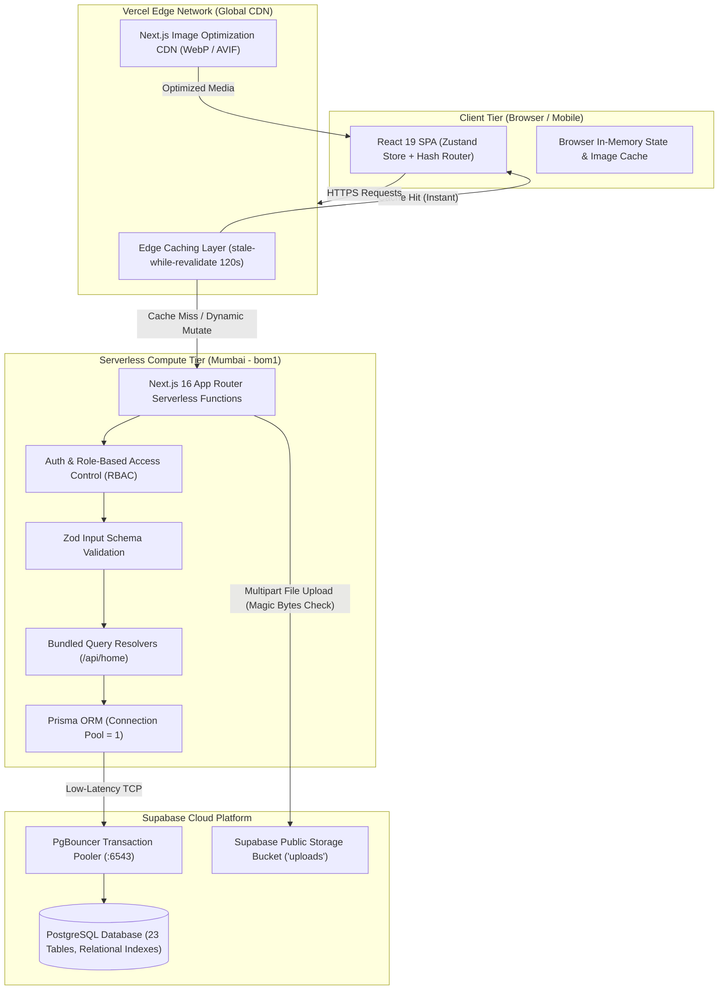
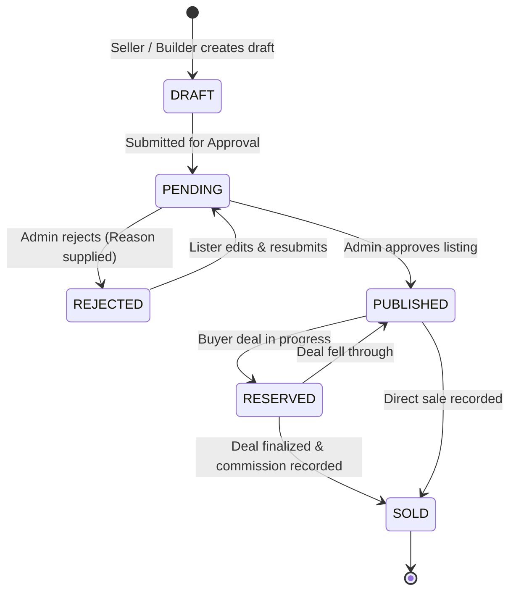
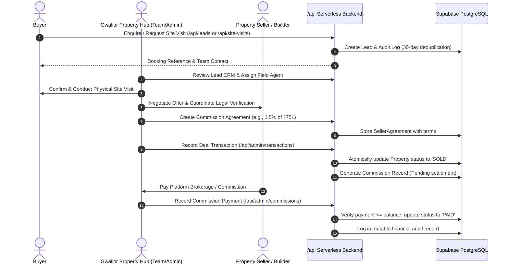
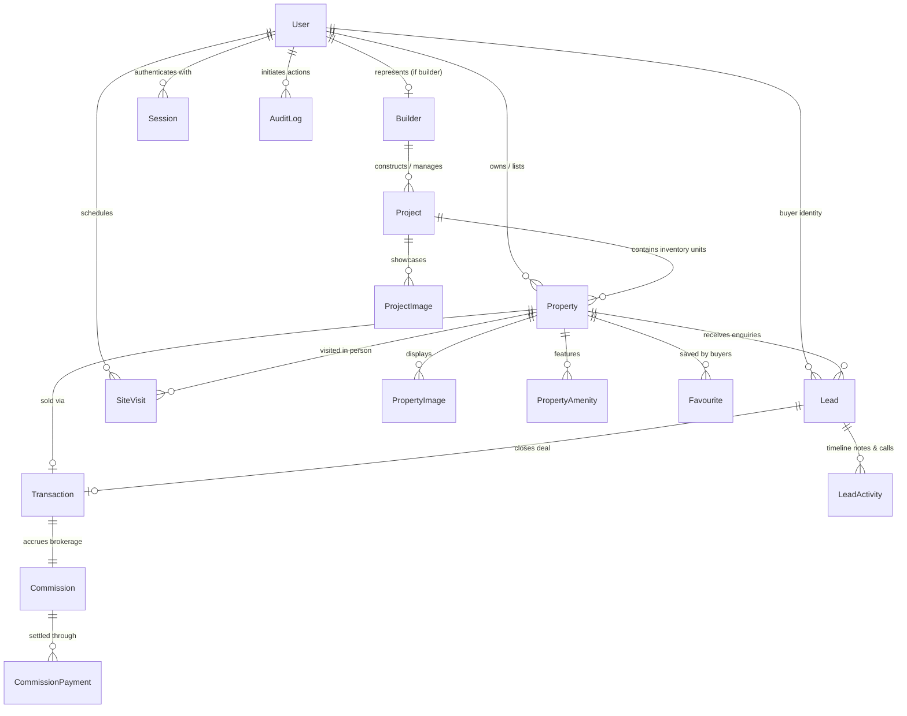

# Gwalior Property Hub — System Architecture & Data Flow Guide

This document provides a comprehensive technical overview of the architecture, component hierarchy, data models, state machines, and end-to-end business workflows powering **Gwalior Property Hub**.

---

## 1. High-Level Infrastructure & Topology

The application is architected as an edge-accelerated, serverless full-stack web application hosted on **Vercel** and backed by **Supabase Cloud Infrastructure** (PostgreSQL + S3 Storage).

---

## 2. End-to-End Business Workflows

Gwalior Property Hub handles the complete Indian real estate brokerage lifecycle in code, strictly enforced server-side.

### A. Property Listing & Verification Lifecycle

---

### B. Lead Generation, Negotiation & Commission Settlement Flow

---

## 3. Database Entity-Relationship (ER) Architecture

The platform utilizes a structured 23-table relational schema managed through Prisma ORM.

---

## 4. API & Route Architecture

All business logic and security policies reside strictly on the server across 30+ serverless endpoints:

### Core Route Clusters

| Cluster | Key Routes | Capabilities | Security & Performance |
|---|---|---|---|
| **Public Marketplace** | `GET /api/home` `GET /api/properties` `GET /api/properties/[id]` `GET /api/projects` `GET /api/insights` | Bundled discovery, multi-city filtering (21 cities), ₹/sq.ft price intelligence, full listing details | Edge CDN cached (`s-maxage=60`), bundled parallel DB queries, rate-limited |
| **Authentication & Profile** | `POST /api/auth/register` `POST /api/auth/login` `POST /api/auth/logout` `GET /api/auth/me` `POST /api/auth/change-password` | Scrypt password hashing, session tokens, role issuance, profile management | HttpOnly partitioned CHIPS cookies, constant-time validation |
| **Lister Dashboard** | `POST /api/properties` `PATCH /api/properties/[id]` `DELETE /api/properties/[id]` `POST /api/upload` | Listing builder, image manager with sorting, unit inventory linked to projects | Role-guarded (`SELLER`, `BUILDER`, `ADMIN`), magic byte upload sniffing |
| **CRM & Site Visits** | `POST /api/leads` `PATCH /api/leads/[id]` `POST /api/site-visits` `PATCH /api/site-visits/[id]` | Multi-stage pipeline (`NEW` → `QUALIFIED` → `NEGOTIATION` → `CONVERTED`), visit scheduler | 30-day duplicate lead protection, WhatsApp API notifications |
| **Admin Command Centre** | `GET/POST /api/admin/users` `GET/POST /api/admin/transactions` `GET/POST /api/admin/agreements` `GET/POST /api/admin/commissions` `GET /api/admin/audit-logs` | User verification, listing approval/rejection, transaction records, commission reconciliation | Strictly Admin role-guarded (`requireUser(['ADMIN'])`), immutable audit logging |

---

## 5. Performance Engineering Highlights

1. **Mumbai Serverless Execution (`bom1`):**  
   Configured in `vercel.json` to ensure serverless lambdas run in Mumbai, cutting cross-continental latency for Indian users by **200–300ms**.
2. **Bundle Aggregation (`/api/home`):**  
   Consolidates 5 independent homepage API calls into a single endpoint running parallel database queries in one TCP roundtrip.
3. **Connection Pooling Guard (`connection_limit=1`):**  
   Every serverless function instance is capped to a single connection to prevent connection exhaustion on Supabase's transaction pooler under traffic spikes.
4. **Edge CDN Stale-While-Revalidate:**  
   Public search and discovery payloads are cached at Vercel's global edge network for 60 seconds and served stale for up to 120 seconds while revalidating in the background.

---

## 6. Security & Compliance Measures

- **No Plaintext Secrets:** Passwords hashed with scrypt + salt. Session cookies configured with `HttpOnly`, `SameSite=None`, `Secure`, and `Partitioned` (CHIPS) for iframe/preview compatibility.
- **Strict Role Boundaries:**
  - `BUYER`: Can browse, save favourites, submit requirements, book site visits.
  - `SELLER`: Can manage own property listings and view enquiries.
  - `BUILDER`: Can manage company profile, projects, and unit inventories.
  - `ADMIN`: Full access to moderation, financial records, audit logs, and user verification.
- **Upload Hardening:** Multipart uploads validate MIME headers, file extensions, and inspect binary magic bytes (JPEG `FF D8`, PNG `89 50 4E 47`, WebP `RIFF...WEBP`).
