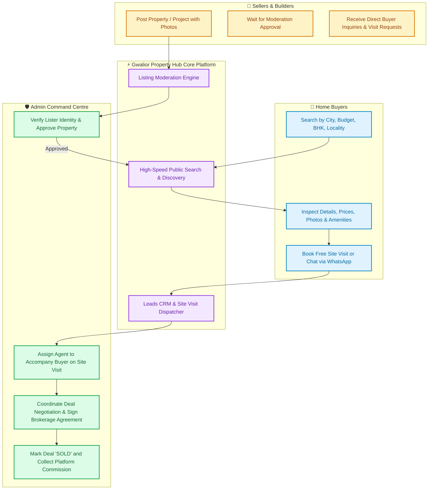
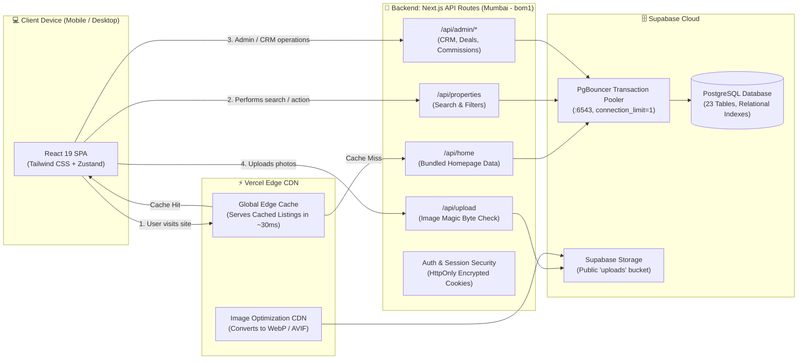
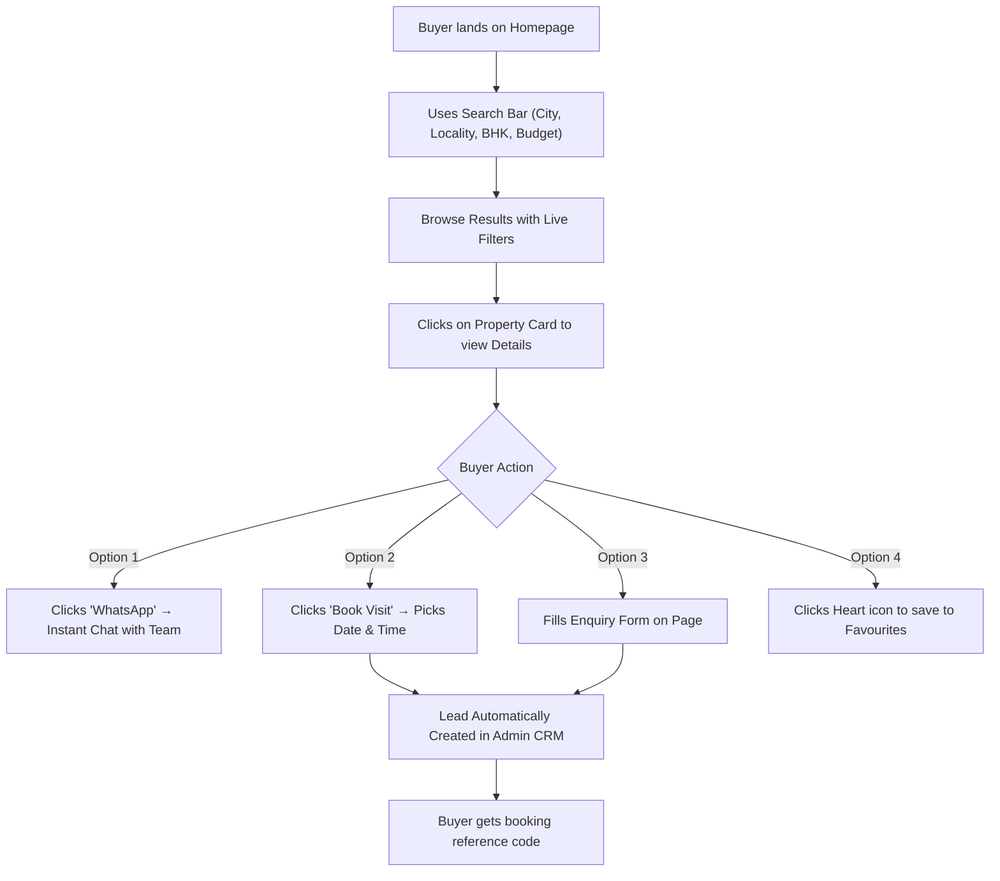
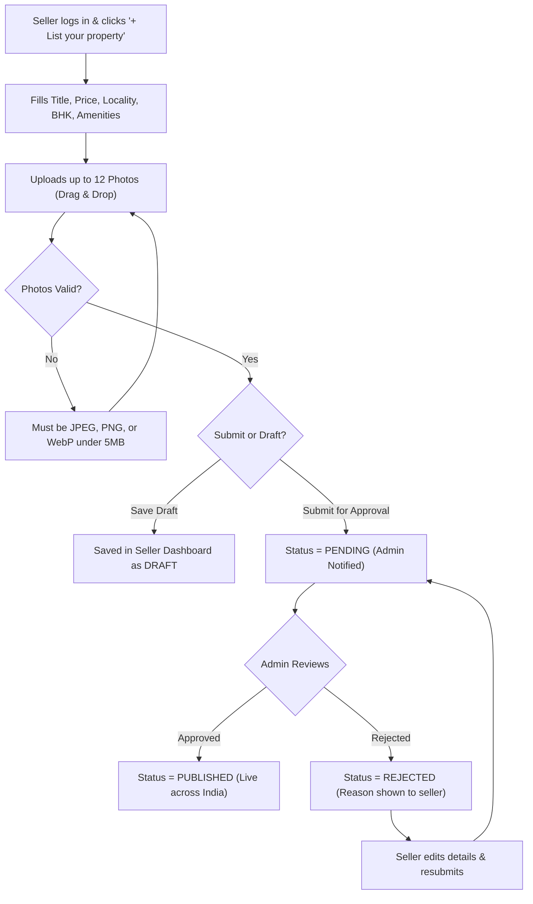
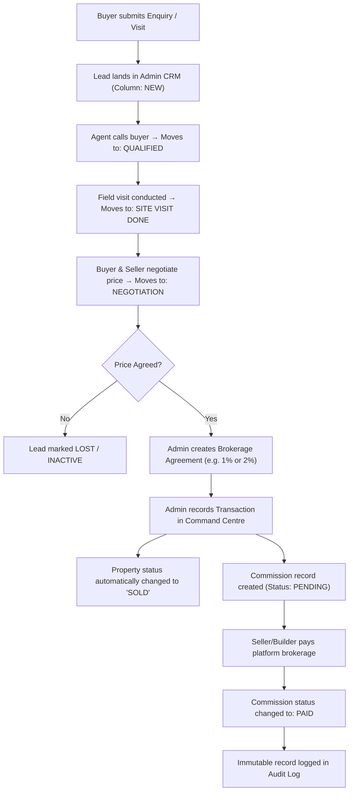

# 🏡 Gwalior Property Hub — Complete Project & Architecture Master Guide
> **Everything you need to understand how Gwalior Property Hub works — from real-world business flows to technical architecture, screen guides, and code map.**

---

## 📑 Table of Contents
1. [What is Gwalior Property Hub?](#1-what-is-gwalior-property-hub)
2. [The Big Picture: How the Platform Works (Visual Business Flow)](#2-the-big-picture-how-the-platform-works)
3. [Technical Architecture (How the Software Works)](#3-technical-architecture-how-the-software-works)
4. [Step-by-Step User Workflows & Flowcharts](#4-step-by-step-user-workflows--flowcharts)
   - [A. Buyer Journey (Finding & Enquiring)](#a-buyer-journey-finding--enquiring)
   - [B. Seller & Builder Journey (Listing & Approval)](#b-seller--builder-journey-listing--approval)
   - [C. Admin & Brokerage Journey (Lead CRM & Commission)](#c-admin--brokerage-journey-lead-crm--commission)
5. [Screen-by-Screen Feature Walkthrough](#5-screen-by-screen-feature-walkthrough)
6. [Codebase Map: Which File Controls What?](#6-codebase-map-which-file-controls-what)
7. [Database & Data Flow (In Plain Terms)](#7-database--data-flow-in-plain-terms)
8. [Instant 60-Second Setup Guide](#8-instant-60-second-setup-guide)

---

## 1. What is Gwalior Property Hub?

**Gwalior Property Hub** is a full-stack real estate marketplace and digital brokerage platform designed specifically for tier-2/tier-3 and metro cities in India (starting with Gwalior, Indore, Bhopal, and 18 other major cities).

Instead of just being a classifieds board (like OLX), it is an **assisted digital brokerage platform** that powers the entire transaction lifecycle:
- 🔍 **Buyers** discover verified homes, plots, and flats without spam or fake listings.
- 🏢 **Builders & Sellers** list properties and builder projects with automated document review.
- 🤝 **Platform Admins & Agents** manage the leads CRM, conduct physical site visits, draft commission agreements, record closed deals, and collect brokerage.

---

## 2. The Big Picture: How the Platform Works

Here is how the four roles interact on the platform:



---

## 3. Technical Architecture (How the Software Works)

The app is built using modern **Next.js 16 (App Router)** with serverless architecture.



### Why is it so fast?
1. **Mumbai Serverless Region (`bom1`):** Server functions run in Mumbai, cutting latency by 200–300ms for Indian users.
2. **Bundled Homepage Route (`/api/home`):** Instead of making 5 separate requests for featured properties, recent arrivals, projects, city counts, and market insights, everything loads in **1 single parallel database query**.
3. **Smart Connection Limit (`connection_limit=1`):** Prevents database crashes when hundreds of users browse at the same time.

---

## 4. Step-by-Step User Workflows & Flowcharts

### A. Buyer Journey (Finding & Enquiring)



---

### B. Seller & Builder Journey (Listing & Approval)



---

### C. Admin & Brokerage Journey (Lead CRM & Commission)



---

## 5. Screen-by-Screen Feature Walkthrough

| Screen | What happens here? | Key File |
|---|---|---|
| **🏠 Homepage** | Hero search bar, 6 featured homes, 6 fresh arrivals, top developer projects, 21-city quick buttons, live ₹/sq.ft price pulse. | `src/components/marketplace/views/home-view.tsx` |
| **🔍 Search & Properties** | Real-time filterable inventory across 21 cities, sort by Price (Low/High) or Newest, active filter chips, instant search pagination. | `src/components/marketplace/views/properties-view.tsx` |
| **🏡 Property Detail** | Full-width title, price comparison with locality average, touch-enabled photo gallery with lightbox, specs, Google Map location, EMI Calculator, floating mobile WhatsApp & Visit button. | `src/components/marketplace/views/property-detail-view.tsx` |
| **🏗️ Developer Projects** | Builder portfolios, gated community master plans, available units, possession dates, and developer verification badges. | `src/components/marketplace/views/project-detail-view.tsx` |
| **💼 Seller Dashboard** | Add/edit properties, multi-image upload manager, view incoming buyer inquiries, manage scheduled site visits. | `src/components/marketplace/views/dashboard/seller-dashboard.tsx` |
| **🛡️ Admin Command Centre** | 10 Tabs: Overview KPI Charts, User Verification, Property Moderation, Project Approvals, Leads CRM Kanban, Site Visits, Transaction Ledger, Commission Settlement, Agreements, and Audit Logs. | `src/components/marketplace/views/dashboard/admin-dashboard.tsx` |

---

## 6. Codebase Map: Which File Controls What?

```
src/
├── app/
│   ├── api/
│   │   ├── home/route.ts            # Fast bundled query for the entire homepage
│   │   ├── properties/route.ts      # Public search, filters, and seller listing POST
│   │   ├── properties/[id]/route.ts # Single property detail, edit, delete
│   │   ├── projects/route.ts        # Builder projects CRUD
│   │   ├── leads/route.ts           # Enquiry submission and CRM pipeline
│   │   ├── site-visits/route.ts     # Site visit booking and rescheduling
│   │   ├── admin/                   # Financials, commissions, users, approvals
│   │   └── upload/route.ts          # Multipart file upload to Supabase Storage
│   └── page.tsx                     # Single-Page-App hash router entrypoint
│
├── components/marketplace/
│   ├── navbar.tsx                   # Responsive sticky navbar with mobile drawer
│   ├── shared/
│   │   ├── search-bar.tsx           # Multi-select search bar (City, Locality, BHK)
│   │   ├── property-card.tsx        # Standard property card with price & badges
│   │   ├── image-gallery.tsx        # Touch swipe gallery with lightbox
│   │   ├── logo.tsx                 # Responsive brand logo (never breaks on mobile)
│   │   └── emi-calculator.tsx       # Live loan EMI calculator
│   └── views/
│       ├── home-view.tsx            # Flagship homepage
│       ├── properties-view.tsx      # Properties catalog with sidebar filters
│       ├── property-detail-view.tsx # Deep listing detail view with mobile sticky bar
│       ├── project-detail-view.tsx  # Developer project presentation
│       └── dashboard/               # Buyer, Seller, Builder & Admin portals
│
├── lib/
│   ├── db.ts                        # Prisma Client singleton with connection limit
│   ├── auth.ts                      # JWT session tokens, scrypt password checks, RBAC
│   ├── constants.ts                 # 21-city list, localities, BHKs, budgets, amenities
│   └── serializers.ts               # Database to JSON DTO converters
│
└── store/
    └── use-app-store.ts             # Central Zustand store (User, Favourites, Route)
```

---

## 7. Database & Data Flow (In Plain Terms)

The database consists of **23 relational tables** managed through Prisma ORM on PostgreSQL:

1. **`User` & `Session`:** Stores user profiles (Buyer, Seller, Builder, Admin) and encrypted session cookies.
2. **`Property` & `PropertyImage`:** Stores title, description, price, negotiable flag, carpet/plot area, BHK, latitude, longitude, and URLs of uploaded images.
3. **`Builder` & `Project`:** Connects developer companies to their residential projects and unit listings.
4. **`Lead` & `LeadActivity`:** Every time a buyer clicks "Enquire", a Lead record is created with a 30-day anti-spam lock.
5. **`SiteVisit`:** Manages physical visits (Scheduled, Completed, Cancelled).
6. **`SellerAgreement` & `BuilderAgreement`:** Legally documents the commission rate (e.g. 1% of transaction).
7. **`Transaction` & `Commission`:** When a deal closes, records the agreed sale price, calculates commission automatically, and tracks payment settlement.
8. **`AuditLog`:** An un-editable log of every financial and moderation event on the platform.

---

## 8. Instant 60-Second Setup Guide

If you received the `gwalior-property-hub-review.zip` archive:

```bash
# Step 1: Extract the archive and enter directory
unzip gwalior-property-hub-review.zip
cd gwalior-property-hub

# Step 2: Install dependencies (Prisma client generates automatically)
npm install      # or: bun install

# Step 3: Run development server
npm run dev      # or: bun run dev

# Step 4: Open in browser
# Go to http://localhost:3000
```

### 🔑 Test Accounts (Password: `Admin@123` / `Seller@123` / `Buyer@123` / `Builder@123`)
Click "Sign in" on the top right — there are **1-click autofill buttons** to instantly log into:
- 👑 **Admin:** `admin@vasati.in`
- 🏡 **Seller:** `seller@vasati.in`
- 🏢 **Builder:** `builder@vasati.in`
- 👤 **Buyer:** `buyer@vasati.in`

