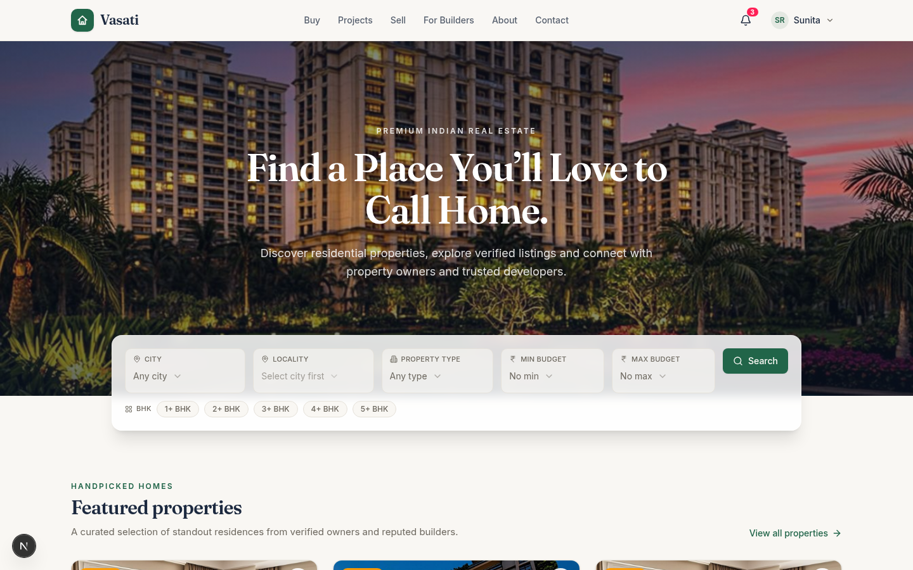

# Vasati — Premium Indian Residential Real Estate Marketplace

Vasati (वासति — "dwelling") is a full-stack, production-grade property marketplace for India, covering the complete brokerage business loop: **listing → moderation → discovery → enquiry CRM → site visits → transaction → commission settlement**.



---

## Demo accounts

| Role | Email | Password | What to try |
|------|-------|----------|-------------|
| **Admin** | `admin@vasati.in` | `Admin@123` | Command Centre: KPIs, approvals, Leads CRM, transactions, commissions, agreements, audit log |
| **Buyer** | `buyer@vasati.in` | `Buyer@123` | Favourites, enquiries, site-visit booking, profile |
| **Seller** | `seller@vasati.in` | `Seller@123` | Listings CRUD with photo upload, enquiry inbox, visit scheduling |
| **Builder** | `builder@vasati.in` | `Builder@123` | Projects, inventory units, RERA profile, enquiries |

The login screen includes one-click demo account fill buttons.

---

## Architecture

```
Next.js 16 (App Router, single "/" SPA with hash routing)
├─ Frontend  React 19 · TypeScript · Tailwind 4 · shadcn/ui · Framer Motion · Recharts · Zustand
├─ API       30+ route handlers under /api (all business logic server-side)
├─ Data      Prisma ORM · SQLite (dev) — schema ported 1:1 to PostgreSQL for production
└─ Auth      scrypt password hashing · httpOnly cookie sessions · role guards
```

### Why hash routing in a single route?

The sandbox exposes one port/route. The app is a classic SPA at `/` using `#/properties`, `#/dashboard?tab=leads`, etc. All views live in `src/components/marketplace/views/`. To deploy as a traditional multi-page app, map each hash path to its view component — no logic changes needed.

---

## Feature map

### Public marketplace
- **Home** — hero, city-wise search, featured properties, trending listings, featured builder projects, city explorer, testimonials
- **Properties** — search + filters (city, locality, type, BHK, budget range, furnishing, construction status, RERA), URL-synced state, sorting, pagination
- **Property detail** — photo gallery with lightbox, specs, amenities, map coordinates, RERA panel, similar homes, enquiry form, site-visit booking, share/save
- **Projects** — developer projects with unit inventories, price bands, amenities, construction status
- **About / Contact / Legal** (privacy + terms), **Partner** (builder onboarding), **List your property** (seller onboarding)

### Role dashboards
- **Buyer** — favourites, enquiries with status timeline, site visits, profile
- **Seller** — listings manager (draft → submit → approved/rejected → resubmit), KPI stats, enquiry inbox with reply notes, visit scheduler, property form with multi-photo upload (drag-drop, main image, reordering)
- **Builder** — project portfolio, unit inventory, enquiries, company profile
- **Admin Command Centre** — 10 tabs: Overview (Recharts KPIs), Users (verify/suspend), Property approvals, Project approvals, Leads CRM (pipeline board, status workflow, follow-ups, assignment), Site visits, Transactions, Commissions (payment recording), Agreements, Audit log

### Business workflow (enforced server-side)
1. Buyer submits enquiry → lead created with unique reference (30-day de-dup, rate-limited, consent required)
2. Admin works lead through pipeline: `NEW → QUALIFIED → NEGOTIATION → BOOKING → CONVERTED`
3. Transaction can only be recorded for a negotiation/booking/converted lead **with an active agreement**
4. Commission is computed server-side from the agreement (percentage of sale value or fixed fee) — never trusted from the client
5. Partial/full commission payments recorded atomically; status auto-transitions `PENDING → PARTIAL → PAID`
6. Every mutation lands in the audit log

---

## API surface (selected)

```
POST /api/auth/{register,login,logout}     GET /api/auth/me
GET  /api/properties                       (search, filters, pagination)
GET  /api/properties/[slugOrId]            POST /api/properties (seller)
PATCH/DELETE /api/properties/[id]          (owner)
POST /api/properties/[id]/approve|reject   (admin moderation)
GET/POST /api/projects                     POST /api/projects/[id]/approve|reject
GET/POST /api/leads                        PATCH /api/leads/[id] (pipeline)
GET/POST /api/site-visits                  PATCH /api/site-visits/[id]
GET/POST/DELETE /api/favourites/[propertyId]
GET /api/stats                             (role-aware dashboard stats)
GET/POST /api/notifications                POST /api/notifications/read-all
POST /api/contact                          POST /api/upload (magic-number validated)
GET/POST /api/admin/users                  PATCH /api/admin/users/[id]
GET/POST /api/admin/transactions           PATCH /api/admin/transactions/[id]
GET/POST /api/admin/agreements             PATCH /api/admin/agreements/[id]
GET /api/admin/commissions                 PATCH /api/admin/commissions/[id] (record payment)
GET /api/admin/audit-logs                  GET /api/admin/stats
```

All endpoints return `{ data }` or `{ error }` with proper HTTP codes, are rate-limited where appropriate, and validate input with Zod.

---

## Data model (23 tables)

`User`, `Session`, `Builder`, `Project`, `ProjectImage`, `Property`, `PropertyImage`, `PropertyAmenity`, `PropertyDocument`, `Favourite`, `Lead`, `LeadActivity`, `SiteVisit`, `SellerAgreement`, `BuilderAgreement`, `Transaction`, `Commission`, `CommissionPayment`, `FeaturedListing`, `Notification`, `AuditLog`, `ContactMessage`, `Setting`

Key constraints: unique property/project slugs, unique lead references, one transaction per lead, payment ≤ outstanding enforced in a DB transaction.

---

## Local development

```bash
bun install
bun run db:push        # sync Prisma schema to SQLite
bun run db:seed        # demo data (8 users, 2 builders, 4 projects, 17 properties, leads, 1 closed deal)
bun run dev            # http://localhost:3000
bun run lint
```

## Production deployment (Vercel + Supabase)

1. **Database** — create a Supabase PostgreSQL project; set `DATABASE_URL` to its connection string. Change the `provider` in `prisma/schema.prisma` from `sqlite` to `postgresql` and run `bunx prisma db push`. No schema changes needed.
2. **Environment** — `NEXT_PUBLIC_SITE_URL` (canonical URL for metadata/OG images).
3. **File uploads** — the dev upload route writes to `public/uploads/`. For serverless, swap the `writeFile` in `src/app/api/upload/route.ts` for Supabase Storage or S3 and return the public URL.
4. **Deploy** — `vercel` (framework auto-detected). Set the env vars in the Vercel dashboard.
5. **Seed admin** — run the seed script against production, then change the demo passwords.

## Security notes

- Passwords: scrypt with per-user salt (never stored in plain text)
- Sessions: opaque tokens in httpOnly cookies, 30-day expiry, revoked on logout
- Session cookie: `SameSite=None; Secure; Partitioned` (CHIPS) — required so
  the app works when embedded in cross-site iframes (e.g. web preview panels).
  `SameSite=Lax` cookies are rejected by browsers in third-party iframe
  contexts, which silently breaks every authenticated API call. Chrome accepts
  `Secure` cookies on localhost, and production is always HTTPS.
- API responses carry `Cache-Control: no-store` so a pre-login 401 can never
  be served from browser cache after signing in
- Every API route validates session + role; object-level ownership checks on all mutations
- Uploads validated by file extension **and** magic-number sniffing, 5 MB cap
- Rate limiting on auth, enquiry, and contact endpoints
- Admin financial mutations are audit-logged with actor, entity, and detail

---

## Design system

- Warm ivory background, deep navy text, premium green primary (`oklch` tokens in `globals.css`)
- Fraunces display serif + Inter body
- Fully responsive (mobile-first), 44px touch targets, focus-visible rings, ARIA-labelled interactive elements, semantic landmarks, sticky-footer layout (`min-h-screen flex-col` + `flex-1` main)
- Loading skeletons, empty states, toast feedback, Framer Motion transitions
