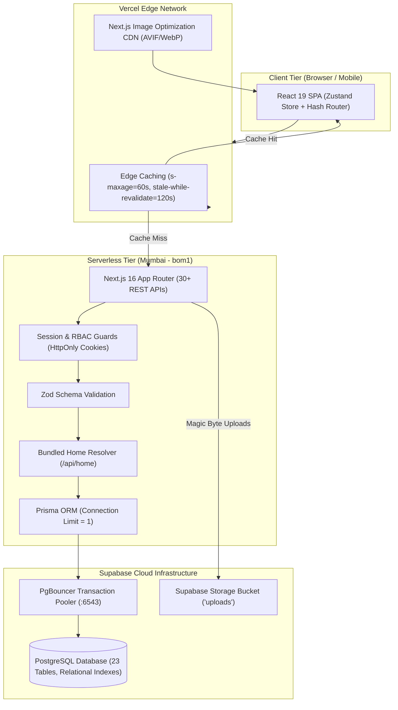
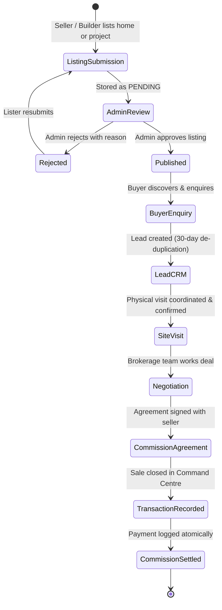

# Gwalior Property Hub — Premium Indian Real Estate Marketplace

Gwalior Property Hub is a full-stack, production-grade property marketplace engineered for Indian real estate dynamics. It covers the complete brokerage business loop: **listing → moderation → discovery → enquiry CRM → site visits → transaction → commission settlement**.

---

## ⚡ Quick Start for Code Reviewers

The project in this archive is **fully pre-configured** with a live Supabase PostgreSQL database and credentials in `.env`. You can run it immediately with just two commands:

```bash
# 1. Install dependencies (Prisma client generates automatically on postinstall)
npm install     # or: bun install

# 2. Start the local development server
npm run dev     # or: bun run dev
```

Open your browser at **[http://localhost:3000](http://localhost:3000)**.

---

## 🔑 Demo Accounts (1-Click Login Ready)

The sign-in page features 1-click autofill buttons for all roles:

| Role | Email | Password | Primary Capabilities |
|---|---|---|---|
| **Administrator** | `admin@vasati.in` | `Admin@123` | **Command Centre:** KPI analytics, property & project approvals, Leads CRM board, agreements, transaction recording, commission settlement, audit logs |
| **Builder / Developer** | `builder@vasati.in` | `Builder@123` | Developer projects portfolio, unit inventory management, RERA profile, developer enquiries |
| **Property Seller** | `seller@vasati.in` | `Seller@123` | Listings management (Draft / Submit / Edit), multi-photo upload with drag-drop, enquiry inbox, site visit scheduler |
| **Home Buyer** | `buyer@vasati.in` | `Buyer@123` | Favourites watchlist, buyer enquiries timeline, site visit booking, buyer requirements |

---

## 🏗️ System Architecture & Data Flow



> 📖 **Deep Dive Available:** For the complete architectural specification, entity-relationship diagrams, and detailed sequence diagrams, see **[ARCHITECTURE.md](./ARCHITECTURE.md)**.

---

## 🔄 Business Workflow (Enforced Server-Side)



---

## 🛠️ Technology Stack

- **Framework:** Next.js 16.1.3 (App Router with Turbopack)
- **Frontend:** React 19, TypeScript 5.7, Tailwind CSS 4, Radix UI Primitives, Lucide Icons, Framer Motion, Recharts
- **State Management:** Zustand (centralized persistent client store)
- **ORM & Database:** Prisma 6.4 + PostgreSQL on Supabase Cloud (dual-pooler: transaction `:6543` + session `:5432`)
- **Authentication:** Scrypt password hashing with per-user salt + HttpOnly partitioned CHIPS session cookies
- **Validation:** Zod schemas on all mutating endpoints
- **Storage:** Supabase Object Storage with local disk fallback + file-signature magic number inspection

---

## ⚡ Performance Engineering

1. **Regional Edge Placement:** Functions configured for `bom1` (Mumbai, India) via `vercel.json` to eliminate transatlantic serverless latency.
2. **Endpoint Bundling:** `/api/home` combines featured properties, fresh arrivals, developer projects, city counts, and market price intelligence into a single database query burst.
3. **Connection Pooling Guard:** `DATABASE_URL` specifies `connection_limit=1` to guarantee serverless lambdas never exhaust the Supabase PgBouncer pool under high concurrent traffic.
4. **Edge CDN Caching:** Public endpoints return `Cache-Control: public, s-maxage=60, stale-while-revalidate=120`, allowing repeated page loads to serve in under 50ms from Vercel's edge network.
5. **Mobile Viewport Optimization:** Responsive navbar with `whitespace-nowrap` logo, 100% full-width property titles, scaled gallery chevrons, and touch-friendly sticky CTA bars.

---

## 📁 Repository Structure

```
.
├── src/
│   ├── app/                    # Next.js 16 App Router & 30+ REST APIs
│   │   ├── api/                # Serverless route handlers (auth, properties, projects, admin)
│   │   ├── layout.tsx          # Root HTML layout with fonts & notifications
│   │   └── page.tsx            # Flagship SPA container
│   ├── components/             # Modular React UI components
│   │   ├── marketplace/        # Flagship views (Home, Properties, Projects, Detail, Dashboard)
│   │   └── ui/                 # Shadcn accessible primitive components
│   ├── lib/                    # Core business logic, db client, serializers, auth
│   └── store/                  # Zustand global application store
├── prisma/
│   └── schema.prisma           # 23-table relational database schema
├── ARCHITECTURE.md             # Complete architecture diagrams & technical specification
├── vercel.json                 # Mumbai bom1 region and function configuration
└── package.json                # Dependencies, scripts, and postinstall hooks
```

---

## 🛡️ Verification & Type Safety

Run the test and build checks locally:

```bash
# Type check (strict mode, zero errors):
bunx tsc --noEmit

# Production build:
npm run build   # or: bun run build
```
