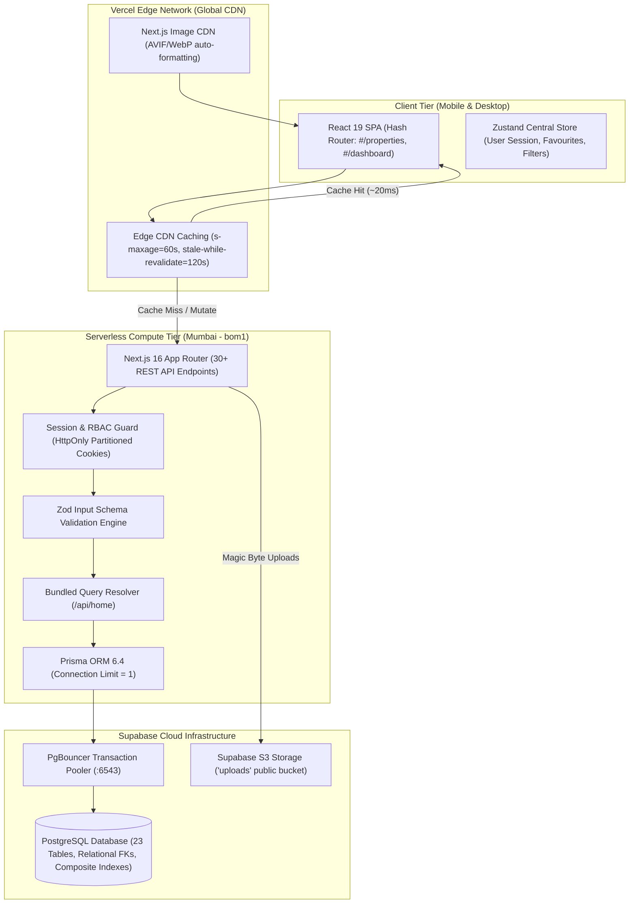
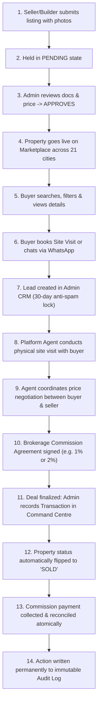
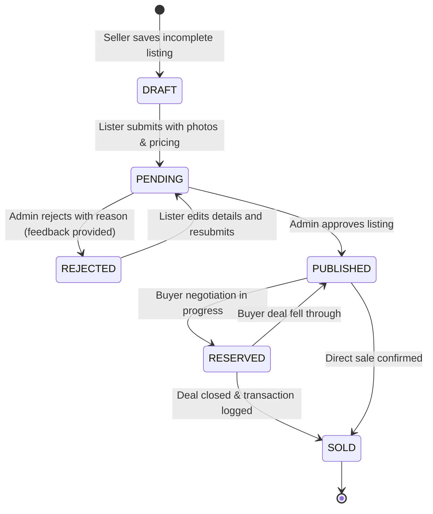

# Gwalior Property Hub — System Architecture & Workflow Specification

This document details the architectural foundation, role workflows, database relationships, and deployment procedures for **Gwalior Property Hub** — an assisted real estate marketplace and digital brokerage platform localized for Indian real estate dynamics.

---

## 1. High-Level System Architecture



- **Frontend Core**: Next.js 16.1.3 App Router with Turbopack, React 19, TypeScript (strict mode), and Tailwind CSS v4.
- **Routing Paradigm**: Single-Page Application (SPA) with Hash-Based Navigation (`window.location.hash`), preserving fast client-side tab and view transitions without route reloading (`/#/properties`, `/#/projects`, `/#/dashboard?tab=...`).
- **State Management**: Zustand store (`useAppStore`) managing user sessions, search filter parameters, cached property data, and dynamic UI modals.
- **Backend API Routes**: Next.js App Router API handlers (`src/app/api/*`) executing asynchronous validation and database transactions.
- **Database Layer**: Supabase PostgreSQL accessed via Prisma ORM 6.4 using connection pooler (`aws-0-ap-southeast-2.pooler.supabase.com:6543`) with `connection_limit=1` and direct fallback for migrations.
- **Security & Authentication**: Scrypt password hashing (`s1:salt:hash`), secure `HttpOnly` `SameSite=none` partitioned cookies, and role-based middleware guards (`ADMIN`, `BUILDER`, `SELLER`, `BUYER`).

---

## 2. Platform Role Workflows & Flowcharts

### 2.1 The Complete Brokerage Business Loop



---

### 2.2 Buyer Workflow
1. **Discovery**: Search residential properties and new builder developments across 21 major Indian cities with locality autocomplete and custom city support.
2. **Filters**: Cascading dropdowns filtering by Property Type (Apartment, Independent House, Villa, Plot), BHK (1 to 5+ BHK), Price Budget Min/Max, and Possession status.
3. **Engagement**:
   - Save properties to personal favourites list.
   - Submit property enquiries with preferred contact times.
   - Request physical site visits with preferred dates and notes.
   - Direct WhatsApp integration for instant communication.

---

### 2.3 Seller & Builder Workflow



1. **Self-Service Registration**: Register as an individual seller or builder with RERA credentials.
2. **Multi-Photo Manager**: Drag-and-drop upload up to 12 high-resolution photos (magic byte validated JPEG/PNG/WebP).
3. **Builder Master Projects**: Create multi-unit developments and link specific inventory units.

---

### 2.4 Admin Command Centre & CRM

```mermaid
flowchart LR
    subgraph CRMStages["CRM Pipeline Stages"]
        S_New["1. NEW LEAD<br/>(Inquiry submitted)"]
        S_Qual["2. QUALIFIED<br/>(Budget & intent verified)"]
        S_Visit["3. SITE VISIT<br/>(Agent visits with buyer)"]
        S_Nego["4. NEGOTIATION<br/>(Price terms finalized)"]
        S_Closed["5. CONVERTED<br/>(Sale closed)"]
    end

    subgraph FinanceLedger["Financial Settlement"]
        Agr["Brokerage Agreement<br/>(Rate % or fixed fee)"]
        Tx["Transaction Record<br/>(Deal Value, Buyer, Seller)"]
        Comm["Commission Calculation<br/>(Deal Value x Rate)"]
        Settled["Commission Paid<br/>(Status: PAID, Audit logged)"]
    end

    S_New --> S_Qual --> S_Visit --> S_Nego --> S_Closed
    S_Closed --> Agr
    Agr --> Tx
    Tx --> Comm
    Comm --> Settled
```



---

## 3. Database Schema Overview (23 Relational Tables)

- **`User`**: Core identity table storing roles (`BUYER`, `SELLER`, `BUILDER`, `ADMIN`), hashed credentials, contact details, and `isVerified` flag.
- **`BuilderProfile`**: 1-to-1 extension of `User` holding RERA credentials, company registration, and developer bio.
- **`Property`**: Residential property listings linked to `sellerId`, with geo-coordinates, locality, pricing, BHK, area, amenities, and status (`PENDING`, `APPROVED`, `REJECTED`, `SOLD`).
- **`PropertyImage`**: Multi-image attachments per property with ordering and `isMain` thumbnail designation.
- **`Project`**: Master builder projects linked to `builderId`, containing launch dates, RERA ID, brochure URLs, and project status.
- **`ProjectUnit`**: Individual inventory unit configurations under a master project.
- **`Lead` & `LeadActivity`**: Buyer inquiries and site visit tracking with 30-day anti-spam window.
- **`SiteVisit`**: Manages physical appointments with calendar scheduling.
- **`SellerAgreement` & `BuilderAgreement`**: Legal commission contracts.
- **`Transaction` & `Commission`**: Financial records tracking deal value, platform percentage, commission amounts, and payment clearance.
- **`AuditLog`**: Append-only audit trail recording every approval, price change, and payment.

---

## 4. Production Build & Deployment

### Build Command:
```bash
bun run build
# OR
npm run build
```

This compiles the Next.js standalone application into `.next/standalone` and executes `scripts/copy-standalone.mjs` to synchronize static assets and public assets into the standalone bundle.

### Running Locally with Live Database:
```bash
npm install     # or: bun install
npm run dev     # or: bun run dev
```
Listens on `http://localhost:3000`.
